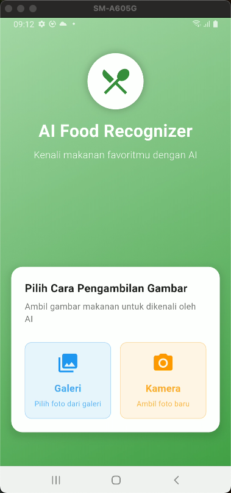
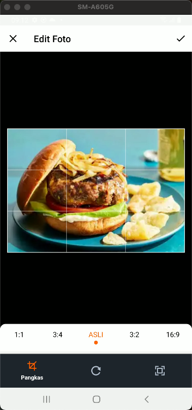
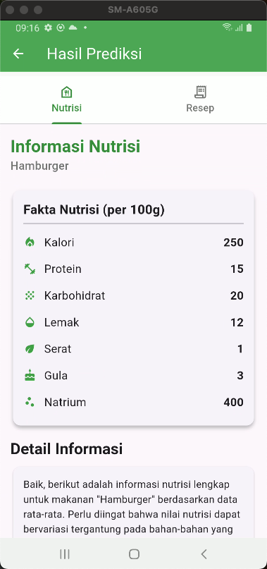
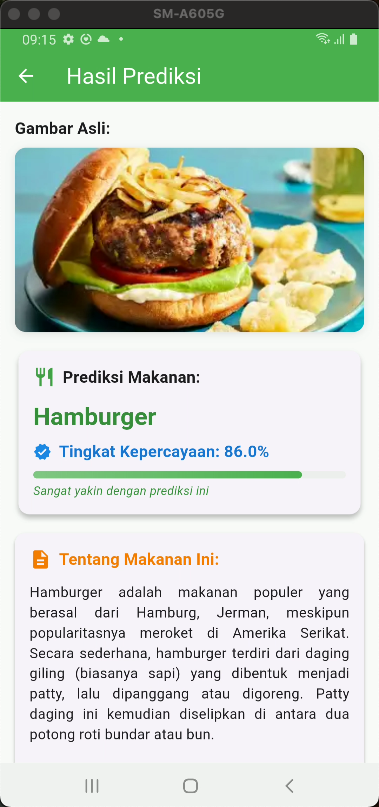

<p align="center">
  
</p>

<h1 align="center">AI Food Recognizer</h1>

<p align="center">
  <b>Foto makanannya, dapat resep dan nutrisinya.</b><br>
  TensorFlow Lite di perangkat + Gemini untuk detail yang lebih kaya.
</p>

<p align="center">
  <a href="https://flutter.dev"></a>
  <a href="https://www.tensorflow.org/lite"></a>
  
  
</p>

---

## ✨ Preview

<p align="center">
  
</p>

<table align="center">
  <tr>
    <td></td>
    <td></td>
    <td></td>
    <td></td>
  </tr>
  <tr>
    <td align="center">Home</td>
    <td align="center">Hasil deteksi</td>
    <td align="center">Nutrisi</td>
    <td align="center">Resep</td>
  </tr>
</table>

---

## 📖 Tentang

Aplikasi Flutter yang mengenali makanan dari foto memakai model **TensorFlow Lite** yang
berjalan di perangkat, lalu melengkapi hasilnya dengan resep dan informasi nutrisi.
Kombinasi on-device ML dan AI cloud memberi detail tanpa harus selalu online.

---

## 🌟 Fitur

- **Pengenalan makanan** dengan model TFLite dari foto kamera atau galeri
- **Confidence score realistis** — bar visual berwarna dan label tingkat keyakinan
- **Saran resep** berdasarkan makanan yang terdeteksi
- **Informasi nutrisi** untuk makanan yang dikenali
- **Multi-label support** dengan file label primer dan fallback
- **Knowledge Graph ID** untuk pencocokan makanan yang lebih akurat
- **Cropping gambar** sebelum prediksi (`image_cropper`)

---

## 🛠️ Tech Stack

| Area | Pilihan |
|---|---|
| Framework | Flutter |
| On-device ML | `tflite_flutter`, `firebase_ml_model_downloader` |
| AI cloud | `google_generative_ai` (Gemini) |
| State management | BLoC |
| Input | `camera`, `image_picker`, `image_cropper` |
| Isolate | `flutter_isolate` untuk inferensi berat |

---

## 🚀 Menjalankan

```bash
flutter pub get
flutter run
```

Model TFLite dan label file diunduh lewat Firebase ML Model Downloader; pastikan project
Firebase sudah dikonfigurasi. API key Gemini diatur di konfigurasi aplikasi.

---

## 📚 Catatan Implementasi

- [Confidence score implementation](docs/confidence_score_implementation.md)

---

## 📄 Lisensi

MIT © Fatchurizkia Ruly Octareza
